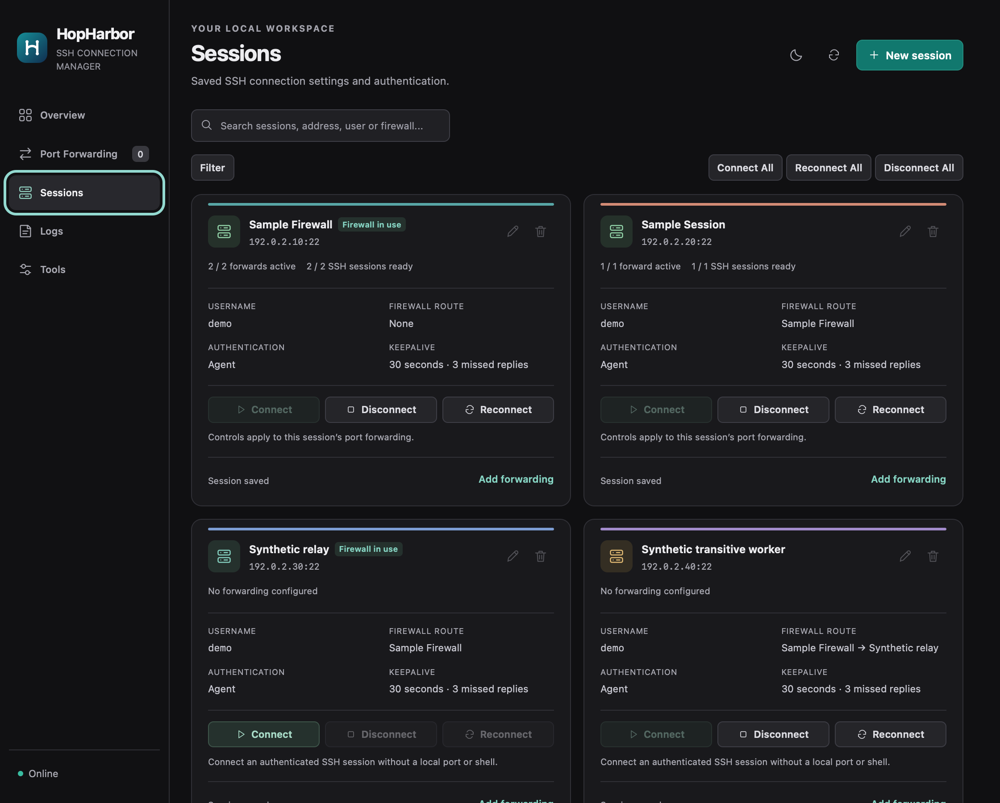
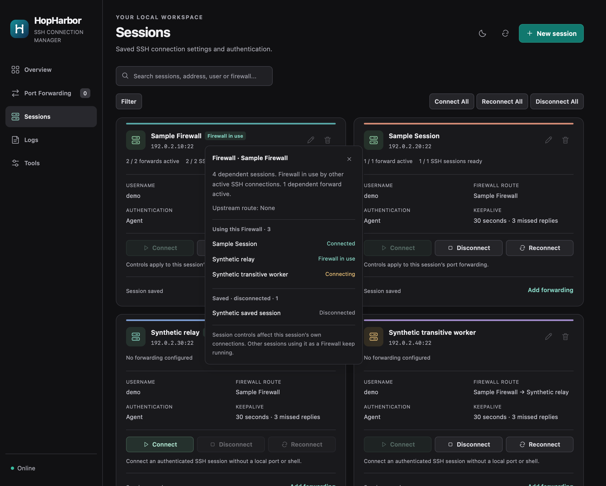
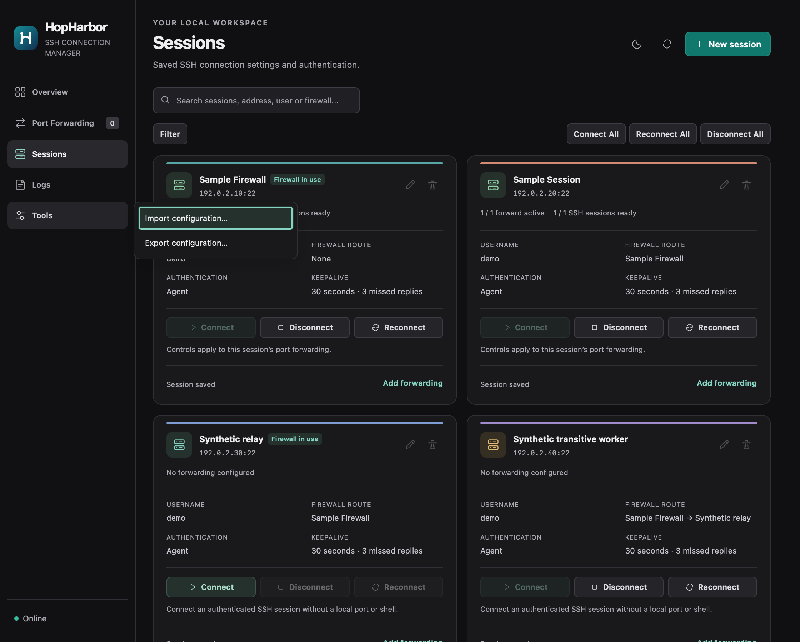

# راهنمای نصب و استفادهٔ HopHarbor

**HopHarbor 1.4.2، بیلد 15:** [نصب مک از سورس](docs/macos-1.4.2.md) · [بسته‌های اوبونتو](#نصب-روی-اوبونتو) · [Windows Preview](packaging/windows/README.md) · [سورس تکمیلی و اعتبارسنجی پلتفرم‌ها](docs/release-1.4.2-platforms.md).


مدیریت اتصال‌های SSH و پراکسی SOCKS/HTTP روی **مک و اوبونتو** و **نسخهٔ آزمایشی ویندوز**، با پنل گرافیکی و سرویس پس‌زمینه.

[English guide](README.md) · [دانلود و انتشارها](https://github.com/kiyanibehzad/HopHarbor/releases/latest)

**سیاست امضای کد:** انتشارهای ویندوز همچنان Preview و بدون امضا هستند. [سیاست امضا](docs/signing/code-signing-policy.md)، [حریم خصوصی](docs/signing/privacy-policy.md) و [ساخت آزمایشی بدون امضا](docs/signing/README.md) وضعیت آماده‌سازی را توضیح می‌دهند؛ پذیرش SignPath هنوز انجام نشده است.

## سیستم‌های پشتیبانی‌شده

**HopHarbor 1.4.2 · بیلد 15** برای مک، اوبونتو و Windows Preview عرضه شده است. تگ و آرشیو اصلی مک حفظ شده‌اند؛ اصلاحات بومی اوبونتو و ویندوز در [سورس تکمیلی و گزارش اعتبارسنجی پلتفرم‌ها](docs/release-1.4.2-platforms.md) مشخص‌اند. [تغییرات مک](docs/release-1.4.2.md).

| سیستم‌عامل | سخت‌افزار | آخرین نسخهٔ منتشرشده | روش نصب |
| --- | --- | --- | --- |
| **macOS 13 یا جدیدتر** | **Apple Silicon / arm64** | 1.4.2 · بیلد 15 (سورس) | [ساخت از سورس](#نصب-روی-مک) |
| **Ubuntu 26.04 LTS Desktop** | **Intel/AMD / amd64** یا **ARM64 / arm64** | 1.4.2 · بیلد 15 | [بستهٔ deb](#نصب-روی-اوبونتو) یا [نصب از سورس](docs/ubuntu.md#install-from-reviewed-source-instead) |
| **Windows Preview — آزمایشی** | **ARM64:** آزمون بومی در VM ویندوز 11 نسخهٔ 25H2؛ **x64:** بستهٔ ساخته‌شده و بررسی‌شده، بدون تأیید بومی ویندوز 11 x64 | 1.4.2 · بیلد 15 | [راهنمای نصب‌کننده و ZIP](packaging/windows/README.md) |

نصب‌کنندهٔ فعلی مک از مدل‌های Intel پشتیبانی نمی‌کند. نسخهٔ اوبونتو ARM در ماشین مجازی بومی تست شده است؛ بستهٔ AMD64 ساخته و ساختارش بررسی شده و [محدودیت آزمون‌ها مشخص است](docs/ubuntu-testing.md).

پنل‌های بومی پس از انقضای کوکی، ورود محلی را بدون راه‌اندازی دوبارهٔ اتصال‌های پس‌زمینه بازیابی می‌کنند. حفاظت بومی فریم، دسترسی فریم فرزند به بازیابی را محدود می‌کند. انتشارهای قبلی حفظ شده‌اند. وضعیت آزمون‌های [مک](docs/macos-panel-recovery.md)، [اوبونتو](docs/ubuntu-panel-recovery.md) و [ویندوز](docs/windows-panel-recovery.md) مشخص است.

## نسخهٔ آزمایشی ویندوز — 1.4.2 · بیلد 15

- **Intel / AMD x64:** [دانلود نصب‌کننده](https://github.com/kiyanibehzad/HopHarbor/releases/download/v1.4.2/HopHarbor-1.4.2-windows-x64-setup.exe).
- **Windows 11 ARM64:** [دانلود نصب‌کننده](https://github.com/kiyanibehzad/HopHarbor/releases/download/v1.4.2/HopHarbor-1.4.2-windows-arm64-setup.exe).
- [ZIP قابل‌حمل ARM64](https://github.com/kiyanibehzad/HopHarbor/releases/download/v1.4.2/HopHarbor-1.4.2-windows-arm64-portable.zip) · [ZIP قابل‌حمل x64](https://github.com/kiyanibehzad/HopHarbor/releases/download/v1.4.2/HopHarbor-1.4.2-windows-x64-portable.zip) · [فایل SHA-256 ویندوز](https://github.com/kiyanibehzad/HopHarbor/releases/download/v1.4.2/HopHarbor-Windows-1.4.2-SHA256SUMS.txt) · [راهنمای نصب و محدودهٔ آزمون](packaging/windows/README.md).

نصب‌کننده را با حساب عادی خود اجرا کنید و HopHarbor را از Start باز کنید. OpenSSH Client و Microsoft Edge WebView2 Runtime باید از قبل موجود باشند. برنامه با تنظیمات خالی شروع می‌شود؛ Sessionهای خودتان را وارد کنید. بستهٔ آزمایشی امضای انتشار ندارد.

محمولهٔ ARM64 با کاربر عادی روی **Windows 11 Pro 25H2 ARM64، بیلد 26200.9711** آزموده شد. اجرای Python، کنترل‌گر، کمک‌ابزار و OpenSSH محصول با مسیر، هش و معماری PE واقعی بررسی شد؛ Python سرور مصنوعی جداگانه و موتور Inno Setup با شبیه‌سازی x64 اجرا شدند. Windows همچنان **Preview — آزمایشی** است: اجرای بومی Windows 11 x64، خواب واقعی، تغییرات واقعی شبکه/ورود/RDP، یکپارچگی SSH-agent، امضا/اعتبار برنامه و نصب روی سیستم آماده‌سازی‌نشده در محدودهٔ این تأیید نیستند.

سابقهٔ سازگاری Windows 10 x64 مربوط به **1.3.2** است؛ شکست قبلی آزمون گروهی انتقال ۲ MiB با مهلت چهار ثانیه حفظ شده است. موفقیت جدید ARM64 این شکست تاریخی را بازنویسی نمی‌کند و تأیید بومی x64 نسخهٔ فعلی نیست. [اعتبارسنجی تاریخی ARM64](docs/windows-arm64-validation-1.3.2.md) و [راهنمای فعلی ویندوز](packaging/windows/README.md) محدودهٔ شواهد را مشخص می‌کنند.

## نصب

### نصب روی اوبونتو

بستهٔ مناسب سخت‌افزار اوبونتو را دانلود و دستور همان معماری را در پوشهٔ دانلود اجرا کنید:

**Intel / AMD — amd64:** [دانلود hopharbor_1.4.2_amd64.deb](https://github.com/kiyanibehzad/HopHarbor/releases/download/v1.4.2/hopharbor_1.4.2_amd64.deb)

```sh
sudo apt install ./hopharbor_1.4.2_amd64.deb
```

**ARM64 — arm64:** [دانلود hopharbor_1.4.2_arm64.deb](https://github.com/kiyanibehzad/HopHarbor/releases/download/v1.4.2/hopharbor_1.4.2_arm64.deb)

```sh
sudo apt install ./hopharbor_1.4.2_arm64.deb
```

سپس **HopHarbor** را از فهرست برنامه‌ها باز کنید و Sessionها و پورت‌فورواردهای خودتان را بسازید. بسته شامل GOST تأییدشده است و APT کتابخانه‌های موردنیاز دسکتاپ را نصب می‌کند.

[راهنمای کامل اوبونتو، نصب از سورس و ارتقا](docs/ubuntu.md) · [فایل SHA-256](https://github.com/kiyanibehzad/HopHarbor/releases/download/v1.4.2/HopHarbor-Ubuntu-1.4.2-SHA256SUMS.txt)

### نصب روی مک

برای **macOS 13 یا جدیدتر روی Apple Silicon**. روش فعلی، ساخت برنامه از سورس است و به **Python 3.9+، Git و Xcode Command Line Tools / Swift** نیاز دارد. اگر ابزارهای اپل نصب نیستند، ابتدا `xcode-select --install` را اجرا و نصب آن‌ها را کامل کنید.

پس از بررسی سورس اجرا کنید:

```sh
git clone --branch v1.4.2 https://github.com/kiyanibehzad/HopHarbor.git
cd HopHarbor
python3 install.py
open "$HOME/Applications/HopHarbor.app"
```

نصب‌کننده برای کاربر فعلی و بدون `sudo` برنامه، کمک‌ابزار Keychain و سرویس پس‌زمینه را می‌سازد و راه می‌اندازد. این ساخت محلی، انتشار notarized اپل محسوب نمی‌شود. حساب SSH معتبر با اجازهٔ TCP forwarding روی تمام سرورهای زنجیره لازم است.

برنامه در `~/Applications/HopHarbor.app` و داده‌های خصوصی در `~/Library/Application Support/HopHarbor` قرار می‌گیرند. گزینه‌های نصب سفارشی در [راهنمای کامل مک](README.md#macos-installation-details) آمده‌اند.

## تصاویر برنامه — 1.4.2 · بیلد 15

این تصاویر از پنل مشترک HopHarbor روی **macOS** ثبت شده‌اند؛ تصویر بومی اوبونتو یا ویندوز نیستند. همهٔ نام‌ها، کاربر `demo`، آدرس‌های مخصوص مستندسازی و وضعیت اتصال‌ها **نمونه‌های ساختگی** هستند و تنظیمات شخصی یا اتصال زندهٔ سرورها را نشان نمی‌دهند.

### Sessionها، رنگ‌ها و کنترل اتصال



### وابستگی‌های Firewall



### منوی Tools: ورود و خروج تنظیمات



## اجرای پس‌زمینه و اجزای برنامه

موتور SSH همان OpenSSH سیستم‌عامل است. مک از launchd و Keychain و اوبونتو از systemd و GNOME Keyring استفاده می‌کند. GOST جزء اضافه‌ای برای پراکسی HTTP و توزیع اتصال‌هاست و جزو ابزارهای داخلی سیستم‌عامل نیست. نسخهٔ آزمایشی ویندوز از OpenSSH سیستم، Windows Credential Manager، پنل WebView2 و پراکسی داخلی پروژه استفاده می‌کند و فایل اجرایی GOST ندارد. بستن پنجره، سرویس اتصال‌ها را قطع نمی‌کند. سورس و بسته‌های عمومی شامل تنظیمات، رمزها یا کلیدهای شخصی نیستند.

## اصطلاح‌های پنل

| اصطلاح | معنی |
| --- | --- |
| **Session** | پروفایل اتصال SSH شامل آدرس، پورت، نام کاربری، روش ورود و هویت مورداعتماد سرور. |
| **Firewall** | یک Session واسط برای رسیدن به Session دیگر؛ یعنی زنجیرهٔ SSH. این گزینه پراکسی دلخواه SOCKS/HTTP یا قانون فایروال مک نیست. |
| **Port Forwarding** | پورت محلی SOCKS، HTTP یا TCP که از یک Session عبور می‌کند. |
| **Connect / Disconnect** | شروع یا توقف همان پورت‌فوروارد و پردازش‌های SSH مدیریت‌شدهٔ آن. |

## ساخت اولین اتصال

۱. در بخش **Sessions** یک Session با آدرس سرور، پورت SSH و نام کاربری اضافه کنید.

۲. روش ورود را انتخاب کنید:

| روش | کاربرد |
| --- | --- |
| **Agent** | استفاده از کلیدی که در SSH agent کاربر فعلی حاضر است. |
| **PublicKey** | استفاده از فایل کلید خصوصی موجود؛ اگر رمزگذاری شده باشد، می‌توان passphrase آن را هم ذخیره کرد. |
| **Password** | استفاده از رمز حساب SSH روی سرور. |
| **PublicKey + Password** | فایل کلید خصوصی همراه رمز حساب سرور؛ passphrase اختیاری کلید هم پشتیبانی می‌شود. |

رمز حساب و passphrase کلید دو چیز متفاوت‌اند. هر دو روش کلیدی، passphrase اختیاری دارند. رمزها در Keychain مک ذخیره می‌شوند و در فایل JSON یا پاسخ وضعیت نمایش داده نمی‌شوند.

۳. کلید عمومی هویت سرور (**Host Key**) را از مسیر مستقلاً مورداعتماد بگیرید و در تنظیمات پیشرفتهٔ Session وارد کنید. کلید میزبان با کلید خصوصی ورود شما فرق دارد. خروجی `ssh-keyscan` بدون مقایسه با اطلاعات مورداعتماد، به‌تنهایی اثبات هویت سرور نیست. برنامه بررسی هویت را برای اتصال‌های ناشناس یا کلید تغییریافته خاموش نمی‌کند.

۴. اگر مسیر واسط لازم دارید، ابتدا Session واسط را بسازید و سپس آن را در **Firewall** مقصد انتخاب کنید. ورود معتبر و کلید میزبان هر واسط باید جداگانه آماده باشد.

۵. در **Port Forwarding** یک پورت استفاده‌نشده انتخاب و یکی از این نوع‌ها را اضافه کنید:

- **SOCKS:** مقصد هر اتصال را برنامهٔ مصرف‌کننده تعیین می‌کند.
- **HTTP:** پراکسی HTTP محلی؛ سایت‌های HTTPS از CONNECT عبور می‌کنند.
- **TCP forward:** مقصد ثابت شامل آدرس و پورت، مثلاً یک سرویس یا پراکسی HTTP موجود روی سرور.

۶. **Connect** را بزنید و آزمون پنل را اجرا کنید. پس از موفقیت، برنامهٔ مصرف‌کننده را به آدرس محلی نشان‌داده‌شده متصل کنید. اتصال خودکار را پس از آزمایش فعال کنید.

تمام پورت‌های مصرف‌کننده روی `127.0.0.1` باز می‌شوند و برای همان مک هستند، نه شبکهٔ محلی. آدرس پراکسی HTTP محلی از `http://` استفاده می‌کند، حتی اگر سایت مقصد `https://` باشد.

## وضعیت، چند اتصال و پس‌زمینه

وضعیت **Connected** یعنی پردازش‌های SSH و پورت محلی آماده‌اند؛ سالم بودن همهٔ مقصدهای اینترنت را تضمین نمی‌کند. آزمون پنل و خود برنامهٔ مصرف‌کننده را بررسی کنید. آزمون عمومی TCP فقط باز بودن پورت محلی را می‌سنجد و محدودیتش در نتیجه ذکر می‌شود.

برای هر پورت‌فوروارد می‌توان یک تا چهار نشست SSH داشت. هر اتصال مصرف‌کننده از یک نشست عبور می‌کند؛ این قابلیت اتصال‌های هم‌زمان را توزیع می‌کند و سرعت یک دانلود را با جمع‌کردن چند SSH افزایش نمی‌دهد. ابتدا با یک نشست شروع کنید.

پس از بستن پنجره، آیکون برنامه در Dock و نوار بالای مک می‌ماند و با کلیک روی آن می‌توانید پنل را دوباره باز کنید. **Quit** از Dock، میان‌بر **Command-Q** یا گزینهٔ **Keep in Menu Bar** پنل و آیکون درحال‌اجرای آن در Dock را پنهان می‌کند، اما آیکون نوار بالا می‌ماند. نوار بالا نشان H برنامه را به‌صورت تک‌رنگ و هماهنگ با حالت روشن، تاریک و انتخاب‌شدهٔ مک نمایش می‌دهد؛ آیکون Dock رنگی می‌ماند. از همان آیکون، **Open HopHarbor** پنل و دسترسی Dock را برمی‌گرداند. در حالت پنهان، صفحهٔ وب پنل آزاد می‌شود و بررسی مکرر وضعیت متوقف می‌شود.

گزینهٔ **Quit Menu Bar App** رابط را کامل می‌بندد و آیکون نوار بالا را حذف می‌کند. هیچ‌کدام از این کارها سرویس SSH را قطع نمی‌کنند. برای توقف یک پورت‌فوروارد از **Disconnect** استفاده کنید. خروج از حساب مک، راه‌اندازی مجدد و خاموش‌کردن سیستم می‌توانند رابط را عادی متوقف کنند. پیش از ویرایش یک فوروارد، آن را متوقف کنید؛ پیش از تغییر Session، فورواردهای وابسته به آن را هم متوقف کنید.

سرویس پس‌زمینه هر سه ثانیه بیدارشدن سیستم را با زمان ثبت‌شده در هستهٔ مک یا ساعت‌های حساس به اسلیپ در لینوکس بررسی می‌کند. پس از بیداری تأییدشده، ابتدا به همهٔ اتصال‌های SSH فعال فرمان توقف می‌دهد و با مهلت‌های مشترک منتظر پایان آن‌ها می‌ماند؛ سپس اتصال‌ها روی همان پورت‌ها بازسازی می‌شوند و پردازش پراکسی محلی باز می‌ماند.

حداکثر تا ۹۰ ثانیه پس از بیداری، اتصال‌های SSH ناموفق با فاصلهٔ یک ثانیه دوباره تلاش می‌کنند و پایش با فاصلهٔ نیم‌ثانیه انجام می‌شود. هر اتصال پس از آماده‌شدن به سیاست عادی تلاش مجدد برمی‌گردد؛ پس از تکمیل بازیابی یا پایان این بازه، فاصلهٔ پایش هم عادی می‌شود. عضو موقتاً خرابِ Pool پس از یک ثانیه دوباره قابل انتخاب است تا اتصال سالم‌شده ۱۰ ثانیه کنار گذاشته نماند. زمان بازیابی در همان لاگ محدود ثبت می‌شود. فورواردهای خاموش روشن نمی‌شوند و خطاهای ورود و هویت سرور همچنان نیازمند اصلاح‌اند. آماده‌شدن شبکه و ورود به سرور زمان می‌برد و اتصال‌های قبلی برنامه‌ها ممکن است نیاز به اتصال مجدد داشته باشند. این قابلیت جلوی اسلیپ سیستم را نمی‌گیرد و پراکسی را هنگام خواب کامل فعال نگه نمی‌دارد.

با شروع موفق پردازش جایگزین، خطای پردازش قبلی از وضعیت فعلی پاک می‌شود و خروجی دیرهنگام آن نمی‌تواند وضعیت جدید را تغییر دهد. خطاهای درخواست مصرف‌کننده‌ها در بخش **Logs** ثبت می‌شوند و به‌عنوان خطای دائمی اتصال نمایش داده نمی‌شوند. سابقهٔ همان روز با اتصال مجدد پاک نمی‌شود.

## انتقال از برنامهٔ قبلی

ابتدا از پورت‌های آزمایشی جدا استفاده کنید و مسیر قبلی اینترنت را فعال نگه دارید. بررسی کنید SSH جدید برای اتصال به سرورها به پراکسی برنامهٔ قبلی وابسته نباشد. سپس مصرف‌کننده‌ها را مرحله‌ای منتقل کنید و فقط پس از تأیید، پورت‌های قدیمی را کنار بگذارید. اگر از برنامهٔ مسیریابی پراکسی استفاده می‌کنید، قوانین مربوط به SSH و سرورهای مقصد را هم بررسی کنید تا حلقه ایجاد نشود.

## نگهداری گزارش‌ها

بخش **Logs** فقط **۲۰۰ رویداد آخرِ روز جاری به وقت محلی مک** را در حافظه نگه می‌دارد. رویدادهای تکراری در بازهٔ **۳۰ ثانیه** در یک ردیف ادغام می‌شوند و تعداد رخدادها کنار پیام دیده می‌شود. متن هر پیام حداکثر **۸۰۰ نویسه** است.

هر یک از دو فایل خروجی سرویس حداکثر **۲۵۶ کیبی‌بایت** حجم دارد؛ مجموع سقف آن‌ها **۵۱۲ کیبی‌بایت** است. قبل از نوشتنی که از سقف عبور می‌کند، همان فایل خالی می‌شود و بایگانی دیگری نگه داشته نمی‌شود. محتوای روز قبل هنگام شروع سرویس و پس از نیمه‌شب محلی پاک می‌شود؛ بررسی در زمان بی‌کاری هر **۶۰ ثانیه** انجام می‌شود.

این گزارش‌ها برای وضعیت اتصال و تشخیص خطا هستند؛ ترافیک و گزارش دسترسی اتصال‌ها ثبت نمی‌شود. پیام خطا ممکن است آدرس سرور یا مقصد را داشته باشد؛ پیش از اشتراک‌گذاری آن را بررسی کنید.

## حذف و حریم داده

```sh
python3 install.py --uninstall
```

این فرمان برنامه و LaunchAgent را حذف می‌کند، ولی تنظیمات خصوصی و Keychain را نگه می‌دارد. اگر مسیر دادهٔ سفارشی انتخاب کرده‌اید، همان `--data-dir` را هنگام حذف هم بدهید.

فایل `control.json` و token آن، کلیدهای خصوصی، تنظیمات واقعی، لاگ‌ها و خروجی‌های تشخیصی را عمومی یا وارد Git نکنید. فایل `config.example.json` فقط مثال ساختگی و غیرفعال است. پیش از اشتراک‌گذاری لاگ، آدرس‌ها، نام‌های کاربری و مسیرهای شخصی آن را بررسی کنید.

راهنمای آزمون‌های محلی و اطلاعات مجوز پروژه و اجزای ثالث در [README انگلیسی](README.md) آمده است.

## کنترل Session و Keepalive

در Sessions وضعیت فورواردها، شمار اتصال‌های SSH آماده و استفاده به‌عنوان Firewall جدا دیده می‌شود. Connect، Disconnect و Reconnect در صورت وجود فوروارد روی فورواردهای همان Session عمل می‌کنند؛ اگر فورواردی تعریف نشده باشد، اتصال SSH مستقل و بدون بازکردن پراکسی یا پوستهٔ راه‌دور را کنترل می‌کنند. اتصال‌های Sessionهای دیگر، از جمله وابسته‌های Firewall، متوقف نمی‌شوند. Disconnect All در بخش Sessions اتصال‌های مستقلِ موجود را هم قطع می‌کند، حتی اگر پس از اتصال به آن‌ها فوروارد اضافه شده باشد. Port Forwarding هم بر اساس Session گروه‌بندی شده است.

Keepalive / NO-OP به‌صورت پیش‌فرض روی ۳۰ ثانیه و ۳ پاسخ ازدست‌رفته است؛ مقدار ۰ آن را خاموش می‌کند. این قابلیت از پیام زنده‌بودن رمزگذاری‌شدهٔ OpenSSH استفاده می‌کند. تلاش مجدد پس از قطع پردازش SSH معمولاً با فاصلهٔ ۵ تا ۶۰ ثانیه انجام می‌شود؛ بازهٔ محدود بازیابی سریع پس از بیداری در بالا توضیح داده شده است. خطای ورود یا هویت سرور باید اصلاح شود. اتصال خودکار پس از شروع سرویس را برای هر فوروارد جدا فعال کنید.

ساخته‌شده توسط **Behzad Kiyani** با **Codex** · [GitHub](https://github.com/kiyanibehzad/HopHarbor)
