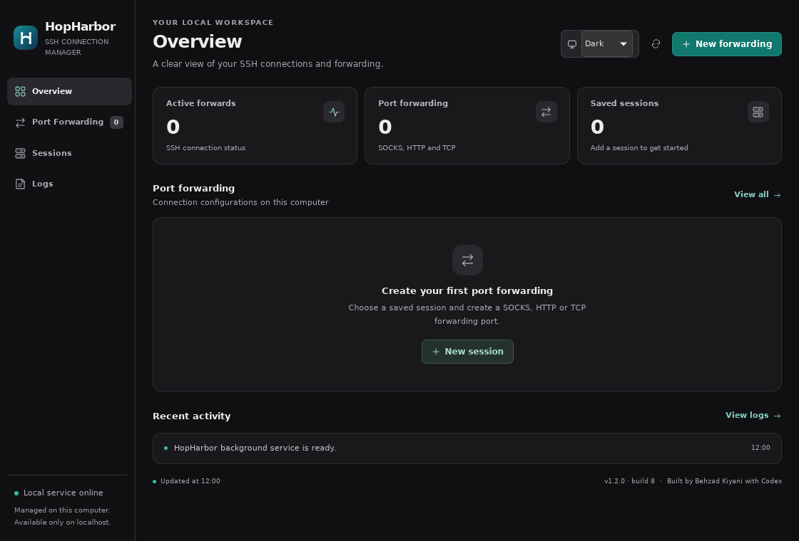
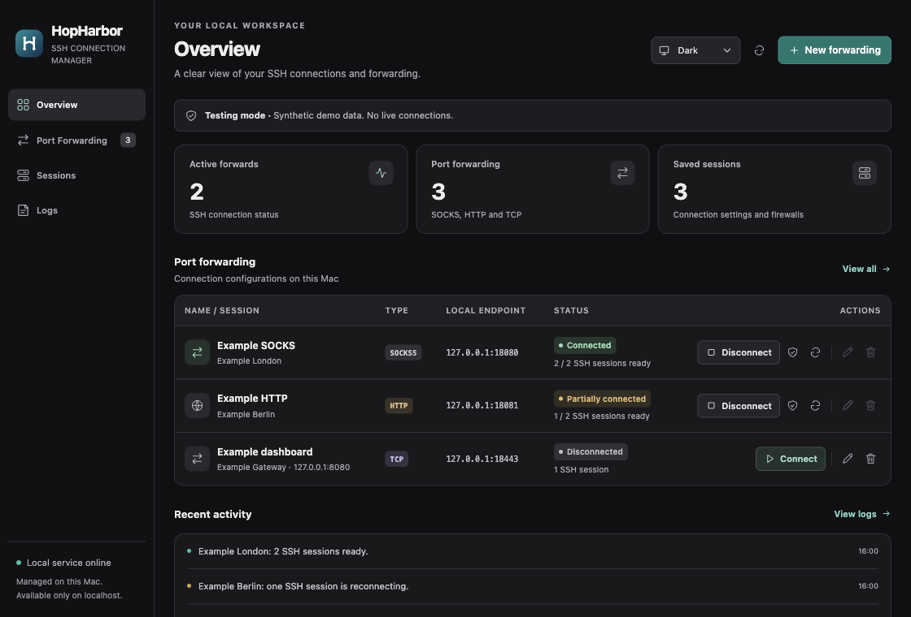
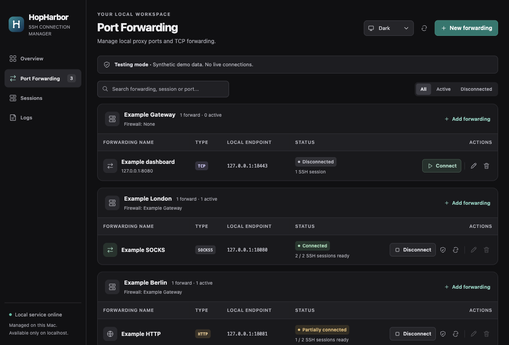
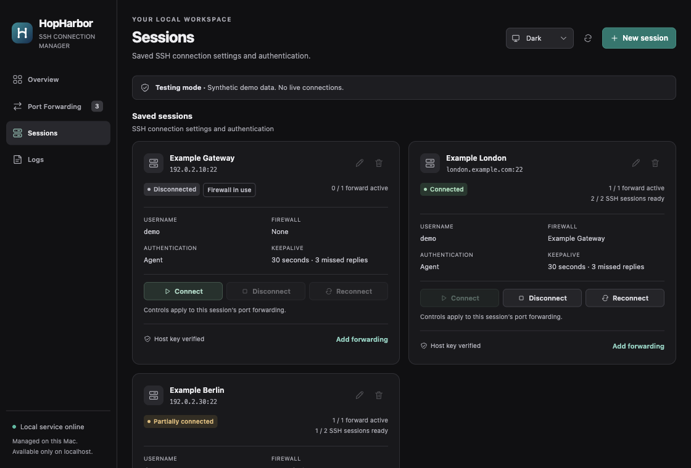

# HopHarbor

Ubuntu **1.2.0** · build **8** | macOS **1.1.4** · build **7**

Built by **Behzad Kiyani** with **Codex** · [GitHub](https://github.com/kiyanibehzad/HopHarbor)

A lightweight interface for the operating system’s OpenSSH client, with SOCKS/HTTP port forwarding and multi-session pools on macOS and Ubuntu 26.04 LTS.

[فارسی: راهنمای شروع سریع](README.fa.md) · [Source repository](https://github.com/kiyanibehzad/HopHarbor)

HopHarbor separates background SSH connections from its native Dock and menu bar panel. It uses the OpenSSH client installed with macOS for SSH, launchd for the user background service, and macOS Keychain for credentials. GOST is an additional, separately downloaded dependency for local HTTP proxying and TCP connection distribution; it is not built into macOS. Closing the panel keeps connections running.

## Ubuntu 26.04 LTS

The Ubuntu edition uses the same local management panel and SSH forwarding engine. It replaces macOS launchd with a per-user systemd service, Keychain with GNOME Keyring / Secret Service, and the macOS window with GTK/WebKitGTK and an application indicator. It supports amd64 and arm64; Linux packages contain no personal Sessions, credentials, or keys.

See **[Ubuntu installation and usage](docs/ubuntu.md)** for `.deb` installation, dependencies, startup, keyring unlocking, and removal. The instructions below this section describe the macOS edition. A closed Ubuntu panel leaves the user service and active forwards running.

## Screenshots

### Ubuntu 26.04 · Dark appearance




These screenshots use **synthetic demo data** only. Example names, documentation-only addresses and simulated connection states do not show a personal configuration or live server connections.

### Overview



### Port Forwarding by Session



### Session controls and status



## Sessions and Port Forwarding

The English interface uses familiar connection-manager terminology:

| Term | Meaning in HopHarbor |
| --- | --- |
| **Session** | A saved SSH connection profile: hostname, SSH port, username, identity or credential, and trusted host key. |
| **Firewall** | An upstream **SSH Session** used to reach another Session. This creates an SSH connection chain. It does not mean an arbitrary SOCKS/HTTP upstream proxy or a macOS firewall rule. |
| **Port Forwarding** | A local SOCKS, HTTP, or TCP forward carried through the selected Session. |
| **Connect / Disconnect** | Start or stop the selected port forward and its managed SSH processes. |

Each Session may select another Session as its Firewall. Create the intermediary Session first. Circular routes are rejected. Each hop keeps its own authentication and trusted server identity.

## Features

- SOCKS4/5 dynamic forwarding, local HTTP proxying, HTTPS destinations through HTTP CONNECT, and fixed TCP forwarding.
- Session chains with per-hop credentials and strict SSH host-key checking.
- Start, stop, restart, edit, and test individual port forwards.
- Optional automatic startup and delayed recovery after an SSH process fails.
- One to four SSH sessions per port forward, distributing new connections across ready sessions.
- Passwords and private-key passphrases stored through macOS Keychain.
- A fully local English management panel in a native macOS app with Dock and menu bar access.

**A pool is not connection bonding.** One client connection uses one SSH session. A pool can distribute concurrent connections; it does not combine SSH sessions to accelerate one download. Start with one session and increase the count only when your workload benefits. Resource use depends on traffic, encryption, and pool size.

## Requirements

- An Apple Silicon Mac running macOS 13 or later.
- Python 3.9+ and a Swift compiler available through Xcode Command Line Tools or Xcode.
- The macOS OpenSSH client, `curl`, and the normal per-user `launchd` environment.
- A working SSH account with TCP forwarding allowed on every server in a connection chain.

Version 1's installer fetches the Darwin arm64 GOST release; Intel Macs are not supported by this installer. No `sudo`, system daemon, VPN driver, browser extension, Node.js, or Python package installation is needed. Source builds are local builds; they are not Apple-notarized releases.

## Install

Review the source, then run from your checkout:

```sh
git clone https://github.com/kiyanibehzad/HopHarbor.git
cd HopHarbor
python3 install.py
open "$HOME/Applications/HopHarbor.app"
```

The installer downloads the pinned official GOST 3.3.1 Darwin arm64 release and verifies its SHA-256 checksum before use. It builds the native app and Keychain helper, installs a per-user LaunchAgent, and starts the controller. The public default configuration has no personal Sessions or active forwards.

| Item | Default location |
| --- | --- |
| Native panel | `~/Applications/HopHarbor.app` |
| Private configuration and runtime data | `~/Library/Application Support/HopHarbor` |
| Background job | User LaunchAgent `local.hopharbor.manager` |

To install without starting the background service:

```sh
python3 install.py --no-start
```

To use a custom private data directory:

```sh
python3 install.py --data-dir "$HOME/Library/Application Support/HopHarbor-Test"
```

The installer embeds that absolute data-directory path in the signed app's `HopHarborDataDirectory` property, so the native panel reads the same controller access file. Without that property, the launcher uses the default location. A custom directory changes the one per-user installation; it does not create a second simultaneous application or LaunchAgent.

## First Session

1. Open HopHarbor from Applications, its Dock icon, or the menu bar.
2. Add a **Session** with a display name, hostname, SSH port, username, and authentication method.
3. Add its verified server public host key in the advanced Session settings.
4. If another SSH server is needed to reach it, create that intermediary Session first and select it as the **Firewall**.
5. Add a **Port Forwarding** entry on an unused local port. Leave automatic startup off until it passes testing.
6. Select **Connect**, run its test, and then configure your client application to use the displayed local address.

### Server identity

HopHarbor uses strict SSH host-key checking. Obtain a server's public host key or expected fingerprint through an independently trusted channel, such as its administrator or a verified server console. A key returned by `ssh-keyscan` is not trusted merely because a server returned it. Verify it independently first.

The host key identifies the server; your private key identifies you to that server. Do not paste a client private key into the host-key field. HopHarbor does not automatically trust new server keys, bypass a changed key, or modify server accounts and authorized keys.

### Authentication

The authentication choices match the Session editor:

| Mode | Credentials used |
| --- | --- |
| **Agent** | A key available in the current user's SSH agent. |
| **PublicKey** | An existing local private-key file; an optional passphrase can be stored if that key is encrypted. |
| **Password** | The SSH account's server password. |
| **PublicKey + Password** | A private-key file plus the server password; an optional key passphrase is also supported. |

Both key modes accept an optional key passphrase. PublicKey + Password additionally makes the account password available when the server's authentication policy requires it. Passwords and passphrases are stored in macOS Keychain; they are not placed in JSON configuration or returned by the status API. The JSON/API values are `agent`, `key`, `password` and `key_password`. Keep private-key files in a private location owned by your macOS user.

An agent key available in an interactive terminal may not be available immediately after a new login. Test automatic startup with the authentication method you intend to use. Arrange valid access to every Session in a Firewall chain before enabling unattended operation.

## Port Forwarding types

| Type | Result | Client setting |
| --- | --- | --- |
| SOCKS | Dynamic destinations through the selected SSH Session. | SOCKS5 proxy at the displayed local address. |
| HTTP | A local HTTP proxy; HTTPS destinations use CONNECT. | HTTP proxy at the displayed local address. |
| TCP forward | One fixed destination host and port reached from the SSH server. | Connect directly to the displayed local port. |

All client-facing local listeners bind to `127.0.0.1`. They serve applications on the same Mac, not other LAN devices.

An HTTP proxy's local address uses `http://` even for an `https://` destination. The local listener is not a TLS-terminating HTTPS proxy. To keep an HTTP proxy already running on a server, use a TCP forward to its remote address and port; that upstream proxy retains its own protocol and authentication.

For SOCKS clients that support it, request remote DNS resolution:

```sh
curl --proxy socks5h://127.0.0.1:18080 https://example.com/
curl --proxy http://127.0.0.1:18081 https://example.com/
```

These are examples for forwards you have created; they do not create connections themselves.

## Status and recovery

Status distinguishes stopped, starting, connected, degraded, and error states. Connected means the SSH processes and local listener are ready, not that every Internet destination is reachable. Use the test action and your actual client application to check traffic.

For a generic TCP forward, a listener test verifies only that the local port accepts a connection. It cannot establish the health of an arbitrary application beyond that port; the test result states this limitation.

SSH keepalives detect an unresponsive SSH connection. Failed processes restart with a delay; authentication and host-key failures need correction instead of rapid endless retries. The background service checks macOS's kernel wake timestamp every three seconds. After a confirmed sleep/wake, it refreshes active SSH transports on their existing local ports and resets their retry delay, rather than waiting for old sockets to time out. Stopped forwards stay stopped, credential and host-key blocks remain, and the proxy frontend stays running. Network availability and authentication still affect recovery time; existing client connections may need to reconnect.

Errors belong to the process that produced them: a successfully started replacement clears its predecessor's status error, and late output from that predecessor cannot overwrite the new state. Client-request errors from the proxy are recorded in today's bounded **Logs** history, separate from persistent component/startup errors. Recovery does not erase that history.

Disconnect a forward before editing it. Stop dependent forwards before changing a Session in their route. Deleting a referenced Session is rejected.

## Moving from another connection manager

Keep the existing working path while you test:

1. Create independent SSH routes on different local test ports.
2. Test every Session, Firewall hop, and authentication method.
3. Confirm the new SSH connections do not depend on proxies supplied by the old application.
4. Move client applications one at a time, retaining a verified fallback.
5. Retire old listeners only after their clients have moved.

If you use a system-wide proxy router, review its rules for SSH processes and their destination servers. Sending a tunnel's own connection back through its proxy can create a loop. HopHarbor does not automatically alter another application's proxy-routing rules.

## Session controls and keepalive

The **Sessions** view shows forwarding status, the count of ready SSH transports, and a separate **Firewall in use** indicator. **Connect**, **Disconnect**, and **Reconnect** apply to the forwarding entries saved under that Session. They do not stop entries belonging to other Sessions, including entries that use this Session as a Firewall. Add a forwarding entry before connecting an otherwise empty Session.

The **Port Forwarding** view groups entries by Session and shows its Firewall route. Search and status filters apply inside those groups.

Each Session has **Keepalive / NO-OP** settings. OpenSSH sends an encrypted server-alive request after the configured interval without receiving traffic. The defaults are 30 seconds and 3 missed replies; interval 0 disables these requests. See the [OpenSSH server-alive settings](https://man.openbsd.org/ssh_config#ServerAliveInterval). This serves the anti-idle and failed-connection detection purpose of SecureCRT's protocol NO-OP, using OpenSSH's own mechanism. Failed SSH processes reconnect with a delay of 5–60 seconds; authentication or host-key errors wait for correction. Enable automatic startup per forwarding entry if it should reconnect after the background service starts.

The installer reuses an unchanged, verified Keychain helper so ordinary interface/controller updates preserve its existing Keychain approval. A changed helper is rebuilt and may require access approval again.

## Background service and removal

Closing the panel keeps its Dock icon available; click it to reopen the panel. Choosing **Quit** from the Dock, pressing **Command-Q**, or choosing **Keep in Menu Bar** hides the panel and its running Dock icon while keeping the HopHarbor menu bar icon available. The menu bar uses a monochrome version of the HopHarbor H mark that follows macOS light, dark, and selected states. The Dock keeps the full-color app icon. Choose **Open HopHarbor** from that icon to restore the panel and Dock access. The hidden panel releases its web view and stops polling for status.

Choose **Quit Menu Bar App** to exit the interface and remove its menu bar icon. All of these actions leave the background SSH service running. Use **Disconnect** to stop a particular port forward. macOS logout, restart, and shutdown are allowed to terminate the interface normally.

To remove the installed app and user LaunchAgent:

```sh
python3 install.py --uninstall
```

Use the same `--data-dir` value if you installed with a custom location. Uninstall preserves private configuration and Keychain items.

## Logs and retention

The **Logs** view keeps only the current local calendar day's latest **200 events** in memory. Duplicate events are collapsed within **30 seconds**, with an occurrence count shown beside the message. Event messages are limited to **800 characters**.

The two service output files are each capped at **256 KiB** (**512 KiB total**). Before a write would exceed the limit, that file is truncated; no archives are kept. Prior-day content is cleared at startup and after local midnight, with an idle check every **60 seconds**.

These are connection and error diagnostics, not traffic or access logs. Error diagnostics may contain server or destination addresses; review them before sharing.

## Configuration and privacy

`config.example.json` uses documentation-only destinations and inactive examples. It is not ready to connect. The configuration schema uses the internal keys `servers` for Session profiles and `tunnels` for Port Forwarding entries; these are API/storage names rather than UI labels.

The panel and controller communicate over loopback. A per-install bootstrap token is exchanged for an HttpOnly, SameSite session cookie; the service validates the request host and origin. Treat private `control.json` and its token as credentials. There is no remote management endpoint.

Do not commit personal configuration, keys, Keychain exports, tokens, runtime files, logs, or diagnostics. Review logs before sharing them because they may contain hostnames, usernames, or file paths. This public checkout includes only source, synthetic examples, tests, and third-party notices.

## Development and local tests

The controller uses Python's standard library; the native panel shell uses Swift/AppKit/WebKit; its interface uses local HTML, CSS and JavaScript. OpenSSH remains the SSH implementation. GOST handles HTTP proxying and connection selection.

Run boundary tests from the repository root:

```sh
python3 -m unittest discover -s tests -v
```

Tests that inspect SSH configuration use `ssh -G`, which expands configuration without contacting a remote server.

For the bounded integration test, first fetch the same pinned GOST binary into the ignored source `bin` directory:

```sh
python3 -c 'from pathlib import Path; import install; Path("bin").mkdir(exist_ok=True); install.fetch_gost(Path("bin/gost"))'
python3 tests/local_smoke.py
```

The test creates temporary SSH keys, two SSH servers, a private TLS CA and HTTP origins entirely on loopback. It does not use personal SSH agents, Keychain credentials, installed HopHarbor settings or remote servers. It tests SOCKS, HTTP absolute-URI requests, CONNECT with certificate verification, TCP forwarding, multiple SSH sessions, and recovery after one child exits. Temporary servers and listeners are stopped afterward. Its generated results file is ignored by Git.

A sanitized development run is recorded in [docs/local-smoke-results.json](docs/local-smoke-results.json). A passing local test is evidence for those cases, not a guarantee for every macOS release, remote server or production workload.

## License and third-party components

HopHarbor's original code is MIT-licensed; see [LICENSE](LICENSE). GOST's MIT notice is retained in [vendor/GOST-LICENSE](vendor/GOST-LICENSE). See [THIRD-PARTY-NOTICES.md](THIRD-PARTY-NOTICES.md) and [vendor/provenance.json](vendor/provenance.json) for its pinned release details. Apple frameworks, the system OpenSSH client and Python remain separately licensed installed components.

## Concurrent connections

The user service requests a soft open-file limit of up to 8,192, bounded by macOS and the inherited hard limit. This prevents the small default launchd limit from rejecting new proxy connections under concurrent traffic. Existing higher limits are preserved; hard limits are not lowered. Service status exposes the effective limits for diagnostics.
